FRONTEND ENGINEERING · SYSTEMS THINKING · APPLIED LEARNING

# Hey, I'm Salman Hashemi.

### I build interfaces. I want to understand the whole system behind them.

Software developer with a Computer Engineering background. 
Grounded in React and TypeScript; growing toward backend, networking, and intelligent applications.

  
  

[About](#about-me) &nbsp; · &nbsp; [Toolkit](#technical-toolkit) &nbsp; · &nbsp; [Projects](#selected-projects) &nbsp; · &nbsp; [Direction](#where-im-going)

---

## ◉ About me

I'm Salman, a frontend developer who likes to follow a problem beyond the screen: through application state, API contracts, backend services, and the data underneath.

My strongest foundation is **modern web application development**. I work with React and TypeScript to build dashboards, reusable components, map-based interfaces, and Persian/English experiences with RTL/LTR support. I care about how an application behaves when data changes, requests fail, or another feature needs to fit into the architecture.

My Computer Engineering studies at the University of Birjand shape that curiosity. Operating systems, networks, algorithms, and computer architecture help me ask better questions about the software I build. My longer-term direction is to understand, design, integrate, and maintain complete systems.

## ◇ What I bring to a project

- **Frontend structure:** component boundaries, shared UI primitives, routing, application state, and reusable data-access patterns.
- **Data-heavy interfaces:** operational dashboards, charts, interactive maps, and visual editors that make complex information easier to work with.
- **Bilingual experiences:** Persian/English localization, document direction, and layouts that accommodate both RTL and LTR content.
- **Engineering habits:** explicit loading and error states, attention to integration boundaries, and decisions that leave room for future changes.

## ⌘ Technical toolkit

I separate tools I use in projects from areas where I'm still building depth.

**My everyday frontend tools**

  
  
  
  

**My applied ML learning projects**

  
  
  
  

<strong>Explore the full toolkit & learning areas</strong>

| Level | Area | Technologies and practice |
| :--- | :--- | :--- |
| **Experienced with** | Frontend | React, TypeScript, JavaScript, HTML/CSS, Tailwind CSS, React Router, i18next |
| **Experienced with** | Interfaces & integration | REST API consumption, React Flow, ELKjs, Neshan/Leaflet maps, dashboard visualization |
| **Experienced with** | Web delivery & workflow | Astro, GSAP, responsive images, Git, Vite |
| **Working knowledge** | Applied ML projects | Python, PyTorch, Hugging Face Transformers, scikit-learn, pandas, Streamlit |
| **Currently exploring** | Backend & data | Java, Spring Boot, SQL, PostgreSQL/PostGIS, Redis, authentication and authorization |
| **Currently exploring** | Networks & systems | TCP/IP, binary protocols, Netty, WebSocket, concurrency, event-driven processing |

---

## Selected projects

### ◈ 01 / [dashboard-core](https://github.com/salman0H/dashboard-core)

A modular dashboard workspace for bringing several interactive tools into a shared application shell.

- Persian/English localization and RTL/LTR switching across the interface.
- A React Flow editor with custom nodes, ELK layout, collision resolution, and node/edge persistence through a mock REST API.
- Hierarchical tree and substation diagram modules, alongside shared routing and UI primitives.

**Built with:** React · TypeScript · Tailwind CSS · i18next · React Flow · ELKjs · JSON Server

### ◈ 02 / [bike-dashboard-core](https://github.com/salman0H/bike-dashboard-core)

A bike-sharing administration prototype that brings fleet, station, user, and financial views into one interface.

- Neshan/Leaflet station maps, route visualization, and shared station-selection state.
- Dashboard charts, bike filters, and API-backed views with loading, error, and fallback handling.
- JSON Server supplies mock data; this repository demonstrates the frontend workflow and integration structure.

**Built with:** React · TypeScript · Tailwind CSS · Neshan Maps · Leaflet · JSON Server

### ◈ 03 / [sentiment-tweet-classification](https://github.com/salman0H/sentiment-tweet-classification)

A learning project for investigating three-class tweet sentiment classification with pretrained Transformer models.

- Configurable BERT, RoBERTa, DistilBERT, and ALBERT experiments, including encoder-freezing options.
- Persisted, stratified train/development/test splits and final evaluation selected by development-set F1.
- A Streamlit interface for pipeline progress, logs, metrics, and resource monitoring.

**Built with:** Python · PyTorch · Hugging Face Transformers · scikit-learn · Streamlit · Plotly

### ◈ 04 / [selpa-portfolio](https://github.com/salman0H/selpa-portfolio)

A Persian portfolio for a handcrafted leather atelier, connecting product storytelling with a responsive web experience.

- React components within Astro, with GSAP motion and layouts adapted for smaller screens.
- Responsive WebP variants, explicit image dimensions, and lazy loading below the fold.
- Reduced-motion support and locally hosted Persian typography.

**Built with:** Astro · React · TypeScript · Tailwind CSS · GSAP · Sharp

[Explore the live site ↗](https://selpa.vercel.app/)

### ◈ 05 / [Hashiyeh · حاشیه](https://github.com/salman0H/Hashieh)

A personal learning workspace that connects classroom conversations, source-backed notes, vocabulary, practice, and reflection on a paper-inspired board.

- An interactive topic graph with React Flow, sticky-note styling, GSAP motion, and reduced-motion support.
- Markdown import with automatic Persian/English block direction, alongside searchable word families and review cards.
- Versioned JSON content, browser-local notes and progress, and an optional server-side Groq study companion.

**Built with:** Next.js · React · TypeScript · GSAP · React Flow · Markdown · Groq

[Project guide ↗](https://github.com/salman0H/Hashieh#readme) · [راهنمای فارسی ↗](https://github.com/salman0H/Hashieh/blob/main/README.fa.md)

---

## ⌁ Following the data: GoldTrax

My involvement in **GoldTrax**, a fleet-tracking platform, is expanding my understanding of how a vehicle position reaches a user: device communication, packet decoding, backend processing, geospatial storage, and delivery to web and mobile clients.

I'm studying how TCP connections and Netty ingestion relate to Spring Boot services, PostgreSQL/PostGIS, Redis, REST APIs, and WebSocket updates. This is an ongoing area of architectural learning alongside my frontend foundation.

The question that keeps me interested: **what has to happen between a device sending a packet and a map showing a trustworthy position?**

## ↗ Where I'm going

<strong>Frontend engineering</strong> 
↓ 
Backend integration 
↓ 
Networks &amp; real-time systems 
↓ 
<strong>Intelligent applications</strong>

These interests connect through the same goal: understanding how data moves, how components cooperate, and where a system can fail.

I'm deepening my knowledge of API design, relational data modeling, authentication, caching, and concurrent processing. In AI, my focus is on the mathematical and computational ideas behind machine learning, NLP, Transformers, and language models, supported by practical Python experiments. I'm also interested in further study and research connecting software engineering, AI, and computer systems.

## ✦ Teaching & life beyond the editor

I've taught advanced web development and mentored programming students. My teaching experience also includes programming fundamentals, advanced programming, and operating systems. Explaining a concept clearly often reveals what I still need to understand about it.

Outside software, I make time for **karate and basketball**.

---

**Good interfaces start with understanding what happens underneath.**

Interested in frontend engineering, system integration, or learning through a practical project? 
[Let's talk.](mailto:salmanhashemi247@gmail.com)

BUILD · UNDERSTAND · EXPLAIN · REPEAT

